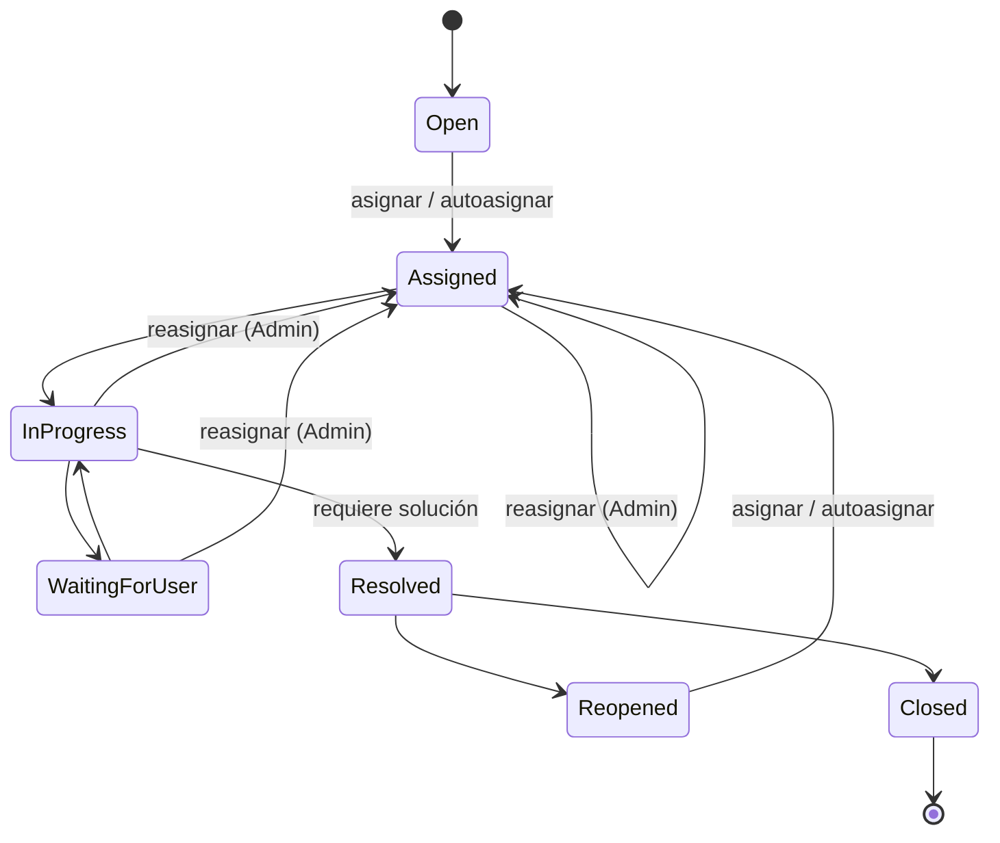

# NexoDesk: Flujo de trabajo de las incidencias

## 1. Decisiones

| #    | Tema                       | Decisión                                                                                                                                   | Justificación                                                                                                           |
| ---- | -------------------------- | ------------------------------------------------------------------------------------------------------------------------------------------ | ----------------------------------------------------------------------------------------------------------------------- |
| D-01 | Prioridad                  | La elige el `Requester` al crear la incidencia (por defecto `Medium`). `Technician` (en sus asignadas) y `Admin` pueden cambiarla después. | El empleado sabe si el problema le impide trabajar, pero no es experto técnico. El técnico puede corregir la prioridad. |
| D-02 | Salida de `WaitingForUser` | La hace siempre el técnico. El comentario del empleado no cambia el estado.                                                                | El técnico mantiene el control del ticket.                                                                              |
| D-03 | Número de ticket           | Cada incidencia tiene un `Number` entero único (secuencia de SQL Server) que la API muestra como `INC-000125`, además del `Guid`.          | Es legible para las personas y permite buscar por número.                                                               |
| D-04 | Reapertura                 | Al reabrir, el ticket pierde su técnico y debe pasar de nuevo por asignación. Lo puede tomar cualquier técnico, incluido el anterior.      | Un ticket reabierto reinicia el proceso, sin bloquear a nadie.                                                          |
| D-05 | Autoasignación             | Un técnico puede tomar un ticket disponible. Pasa a `Assigned` y deja de estar disponible para los demás.                                  | Evita que dos técnicos trabajen lo mismo.                                                                               |
| D-06 | Reasignación               | Reasignar un ticket activo lo devuelve a `Assigned`.                                                                                       | El nuevo técnico debe analizar el caso desde cero.                                                                      |
| D-07 | Cierre                     | Solo desde `Resolved`. Lo hace el `Requester` dueño o el `Admin`.                                                                          | No tiene sentido cerrar algo sin resolver.                                                                              |
| D-08 | Solución al reabrir        | `ResolutionSummary` y `ResolvedAtUtc` se limpian. La solución anterior queda en el historial.                                              | El ticket vuelve a estar sin resolver, pero no se pierde lo que se hizo.                                                |
| D-09 | Trabajo del `Admin`        | El `Admin` asigna, reasigna, cambia prioridad, cierra y reabre. No trabaja tickets (no pasa a `InProgress` ni registra soluciones).        | La resolución es siempre responsabilidad de un técnico.                                                                 |

## 2. Estados

| Estado           | Significado                                                             |
| ---------------- | ----------------------------------------------------------------------- |
| `Open`           | Creada por el empleado. Nadie la ha tomado.                             |
| `Assigned`       | Tiene técnico, pero todavía no ha comenzado a trabajarla.               |
| `InProgress`     | El técnico está trabajando en ella.                                     |
| `WaitingForUser` | El técnico espera información del empleado.                             |
| `Resolved`       | El técnico registró una solución. Espera confirmación o reapertura.     |
| `Closed`         | Cerrada de forma definitiva. Estado final.                              |
| `Reopened`       | El problema persistió. Sin técnico, disponible para volver a asignarse. |

## 3. Diagrama

## 4. Tabla de transiciones

| ID   | Desde                                        | Hacia            | Quién                                           | Condiciones                                                                                                                                    | Efecto sobre los campos                                                            |
| ---- | -------------------------------------------- | ---------------- | ----------------------------------------------- | ---------------------------------------------------------------------------------------------------------------------------------------------- | ---------------------------------------------------------------------------------- |
| T-01 | `Open`                                       | `Assigned`       | `Admin` (asigna) o `Technician` (se autoasigna) | El destino es un usuario activo con rol `Technician`. El ticket no tiene técnico. Si lo ejecuta un `Technician`, el destino debe ser él mismo. | `AssignedTechnicianId` = técnico.                                                  |
| T-02 | `Reopened`                                   | `Assigned`       | `Admin` (asigna) o `Technician` (se autoasigna) | Igual que T-01.                                                                                                                                | `AssignedTechnicianId` = técnico.                                                  |
| T-03 | `Assigned` / `InProgress` / `WaitingForUser` | `Assigned`       | `Admin`                                         | El nuevo técnico está activo, es `Technician` y es distinto del actual.                                                                        | `AssignedTechnicianId` = nuevo técnico.                                            |
| T-04 | `Assigned`                                   | `InProgress`     | `Technician` asignado                           | Ninguna.                                                                                                                                       | Ninguno.                                                                           |
| T-05 | `InProgress`                                 | `WaitingForUser` | `Technician` asignado                           | Ninguna.                                                                                                                                       | Ninguno.                                                                           |
| T-06 | `WaitingForUser`                             | `InProgress`     | `Technician` asignado                           | Ninguna.                                                                                                                                       | Ninguno.                                                                           |
| T-07 | `InProgress`                                 | `Resolved`       | `Technician` asignado                           | `ResolutionSummary` obligatorio (no vacío).                                                                                                    | `ResolutionSummary` = texto. `ResolvedAtUtc` = ahora.                              |
| T-08 | `Resolved`                                   | `Closed`         | `Requester` dueño o `Admin`                     | Ninguna.                                                                                                                                       | `ClosedAtUtc` = ahora.                                                             |
| T-09 | `Resolved`                                   | `Reopened`       | `Requester` dueño o `Admin`                     | Ninguna.                                                                                                                                       | `AssignedTechnicianId` = nulo. `ResolutionSummary` = nulo. `ResolvedAtUtc` = nulo. |

**Cualquier transición que no aparezca en esta tabla está prohibida para todos los roles.** Por ejemplo: `Open` → `Closed`, `Assigned` → `Resolved` o `Closed` → cualquiera.

### Endpoint que ejecuta cada transición

- `PATCH /api/tickets/{id}/assignment`: T-01, T-02 y T-03.
- `PATCH /api/tickets/{id}/status`: T-04 a T-09.

## 5. Historial

Cada transición se registra en `TicketHistory` dentro de la misma operación que modifica el ticket (RN-17). La regla es:

- **Todo cambio de estado** genera un evento `StatusChanged` (`OldValue` y `NewValue` con los estados).
- Además, algunas operaciones generan un evento propio:

| Operación                    | Eventos generados                                                                                                                                              |
| ---------------------------- | -------------------------------------------------------------------------------------------------------------------------------------------------------------- |
| Creación del ticket          | `Created`                                                                                                                                                      |
| T-01, T-02                   | `Assigned` (`NewValue` = técnico) y `StatusChanged`                                                                                                            |
| T-03                         | `Reassigned` (`OldValue` = técnico anterior, `NewValue` = nuevo). Más `StatusChanged` solo si el estado cambió (`InProgress` o `WaitingForUser` → `Assigned`). |
| T-04, T-05, T-06, T-08, T-09 | `StatusChanged`                                                                                                                                                |
| T-07                         | `ResolutionRecorded` (`NewValue` = solución) y `StatusChanged`                                                                                                 |
| Cambio de prioridad          | `PriorityChanged` (`OldValue` y `NewValue` con las prioridades)                                                                                                |

Al reabrir (T-09), el ticket pierde su `ResolutionSummary`, pero la solución anterior sigue disponible en el evento `ResolutionRecorded` que la registró (D-08).

## 6. Estado y campos del ticket

Esta tabla indica qué debe cumplirse siempre. Sirve para detectar datos incoherentes y para escribir pruebas.

| Estado           | `AssignedTechnicianId` | `ResolutionSummary` | `ResolvedAtUtc` | `ClosedAtUtc` |
| ---------------- | ---------------------- | ------------------- | --------------- | ------------- |
| `Open`           | Vacío                  | Vacío               | Vacío           | Vacío         |
| `Assigned`       | Con valor              | Vacío               | Vacío           | Vacío         |
| `InProgress`     | Con valor              | Vacío               | Vacío           | Vacío         |
| `WaitingForUser` | Con valor              | Vacío               | Vacío           | Vacío         |
| `Resolved`       | Con valor              | Con valor           | Con valor       | Vacío         |
| `Closed`         | Con valor              | Con valor           | Con valor       | Con valor     |
| `Reopened`       | Vacío                  | Vacío               | Vacío           | Vacío         |

## 7. Reglas generales

1. `Closed` es un estado final. No admite cambios de estado, prioridad, asignación ni comentarios.
2. El técnico no puede saltarse estados. Para resolver, el ticket debe estar en `InProgress`.
3. Los comentarios no cambian el estado (RN-10). Se pueden agregar en cualquier estado excepto `Closed`, por quienes tengan permiso para comentar según `roles-and-permissions.md`, sección 3.2.
4. El cambio de prioridad es independiente del estado y no genera transición. Está permitido en cualquier estado excepto `Closed`. El `Admin` puede cambiarla en cualquier incidencia y el `Technician` solo en las asignadas a él. Cambiar a la misma prioridad que ya tiene se rechaza con 400.
5. Cada operación actualiza `UpdatedAtUtc`.
6. Toda modificación del ticket usa control de concurrencia (`RowVersion`). Si hay conflicto, la respuesta es 409. Ejemplos: dos técnicos que toman el mismo ticket a la vez, o un `Admin` que reasigna mientras el técnico lo resuelve.
7. Reasignar a un técnico que ya está asignado al ticket se rechaza con 400.
8. El `Requester` puede explicar la reapertura con un comentario, pero no es obligatorio.
9. Si un `Technician` intenta asignar un ticket a otro técnico, la API responde 403.

### Orden de validación y códigos de respuesta

Cuando llega una solicitud sobre un ticket, el sistema valida en este orden y se detiene en la primera falla:

1. **Autenticación y rol del endpoint** (`[Authorize]`). Sin token válido: **401**. Rol no permitido en el endpoint: **403**.
2. **Formato de los datos.** Campos obligatorios ausentes o valores no válidos: **400**.
3. **El ticket existe y está dentro del alcance del usuario.** Si no existe o está fuera de alcance, la respuesta es la misma: **404**.
4. **La transición existe** desde el estado actual (tabla 4). Si no, **400**.
5. **El rol y el alcance del usuario le permiten ejecutarla.** Si no, **403**.
6. **Se cumplen las condiciones** (solución presente, técnico válido y activo, prioridad distinta). Si no, **400**.
7. **Se guarda sin conflicto de concurrencia.** Si hay conflicto, **409**.

## 8. Ejemplo de ciclo de vida

| Paso | Quién      | Acción                            | Estado resultante | Eventos                               |
| ---- | ---------- | --------------------------------- | ----------------- | ------------------------------------- |
| 1    | Requester  | Crea el ticket                    | `Open`            | `Created`                             |
| 2    | Technician | Se autoasigna                     | `Assigned`        | `Assigned`, `StatusChanged`           |
| 3    | Technician | Empieza a trabajar                | `InProgress`      | `StatusChanged`                       |
| 4    | Technician | Pide información                  | `WaitingForUser`  | `StatusChanged`                       |
| 5    | Requester  | Comenta con la información        | `WaitingForUser`  | (comentario)                          |
| 6    | Technician | Retoma el trabajo                 | `InProgress`      | `StatusChanged`                       |
| 7    | Technician | Registra la solución              | `Resolved`        | `ResolutionRecorded`, `StatusChanged` |
| 8    | Requester  | El problema persiste, reabre      | `Reopened`        | `StatusChanged`                       |
| 9    | Admin      | Asigna a un técnico               | `Assigned`        | `Assigned`, `StatusChanged`           |
| 10   | ...        | Se repite el ciclo hasta resolver | `Resolved`        | ...                                   |
| 11   | Requester  | Confirma y cierra                 | `Closed`          | `StatusChanged`                       |

## 9. Pendientes y límites de la versión 1

Los pendientes de este flujo están en `requirements.md`, sección 7 (Pendientes):

- **P-05:** qué pasa con las incidencias activas de un técnico desactivado. Hoy las reasigna manualmente el `Admin` con T-03.
- **P-06:** si un técnico puede soltar una incidencia que se asignó por error.

El cierre automático de incidencias `Resolved` que el empleado nunca confirma está fuera del alcance de la versión 1 (`requirements.md`, sección 5).
